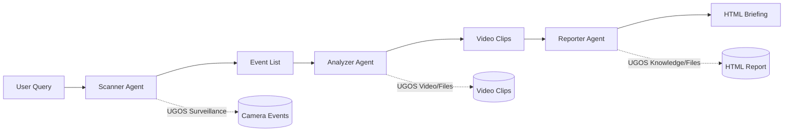

# Watchtower — AI Security Analyzer for UGREEN NAS

[](https://skills.ugreen.com/)
[](LICENSE)
[](https://python.org)

> **Turn unwatched footage into actionable security intelligence.**

Watchtower transforms your security cameras from passive recorders into active intelligence. Ask "What happened last night?" in plain English — get an instant event list, extracted video clips, and an AI-generated HTML briefing with timeline and recommendations.

## 🎯 Quickstart

```bash
# 1. Install (via UGOS Skill Hub or manual)
pip install -e .

# 2. Authorize footage folder (UGOS will prompt)
watchtower authorize /mnt/cameras

# 3. Analyze!
watchtower "analyze last 24 hours"
watchtower "show person detections yesterday"
watchtower "generate briefing for front door last week"
```

## 🏗 Architecture



**3 Expert Agents** orchestrated via Uliya Skill Standard:
| Agent | UGOS Capability | Role |
|-------|----------------|------|
| **Scanner** | Surveillance | Query camera events via natural language |
| **Analyzer** | Video + Files | Extract clips ±30s, save to `/Security/` |
| **Reporter** | Knowledge + Files | AI reasoning → HTML briefing with embedded clips |

## 🔧 Capabilities

| CLI Command | Description | Confirmation |
|-------------|-------------|--------------|
| `watchtower.query_events` | Natural language → structured event list | No (read-only) |
| `watchtower.extract_clips` | Extract ±30s clips around events | **YES** (batch) |
| `watchtower.generate_briefing` | AI-generated HTML report with clips | **YES** (single) |

## 💡 Example Queries

```bash
watchtower "analyze last 24 hours"
watchtower "show person detections yesterday 18:00-22:00"
watchtower "generate briefing for front door camera last week"
watchtower "extract clips for all vehicle detections today"
```

## 🔒 Privacy & Compliance

- **100% Local Processing** — No cloud, no external API calls
- **Face Recognition**: Opt-in only (default OFF) — BIPA/GDPR/UU PDP compliant
- **UGOS Confirmation Gates** — All write ops require explicit approval
- **Zero External Dependencies** — Python stdlib + uliya-skill-kit only

## 📦 Installation

### Via UGOS Skill Hub (Recommended)
1. Open UGOS Skill Hub
2. Search "Watchtower"
3. Click Install → Authorize footage folder → Done

### Manual (Development)
```bash
git clone https://github.com/atenks2026/watchtower.git
cd watchtower
pip install -e .
# Authorize folder via UGOS
watchtower authorize /mnt/cameras
```

## 📁 Project Structure

```
watchtower/
├── SKILL.md              # Uliya Skill Specification (required)
├── README.md             # This file
├── LICENSE               # MIT License
├── pyproject.toml        # Package config
├── watchtower/
│   ├── __init__.py
│   ├── __main__.py       # CLI entry point
│   ├── cli.py            # Command parsing & UGOS registration
│   ├── agents/
│   │   ├── __init__.py
│   │   ├── scanner.py    # Scanner Agent (Surveillance)
│   │   ├── analyzer.py   # Analyzer Agent (Video + Files)
│   │   └── reporter.py   # Reporter Agent (Knowledge + Files)
│   ├── ugos/
│   │   ├── __init__.py
│   │   ├── confirmation.py  # UGOS confirmation gates
│   │   └── streaming_html.py  # OOM-safe HTML generation
│   ├── utils/
│   │   ├── __init__.py
│   │   ├── nlp.py        # Natural language parsing
│   │   └── error_handler.py  # 24 error codes, fallback chains
│   └── references/
│       ├── extraction_schema.md
│       ├── prompt_templates.md
│       ├── privacy_notice.md
│       ├── error_handling.md
│       └── license_table.md
└── tests/
    ├── __init__.py
    └── test_watchtower.py
```

## 🛠 Development

```bash
# Install dev dependencies
pip install -e ".[dev]"

# Run tests
pytest tests/

# Type check
mypy watchtower/

# Lint
ruff watchtower/
```

## 📄 License

MIT License — see [LICENSE](LICENSE) for details.

**Attributions**:
- Built with [UGREEN UGOS Skill Creation Tool](https://skills.ugreen.com/)
- Powered by [NVIDIA Nemotron](https://www.nvidia.com/en-us/ai/)
- Uliya Skill Development Standard

## 🗺 Roadmap

- [ ] Face recognition module (opt-in, BIPA/GDPR/UU PDP)
- [ ] Scheduled briefings via UGOS cron
- [ ] Mobile push notifications for critical anomalies
- [ ] Multi-site dashboard for property managers

---

*Built for [UGREEN AI NAS Hackathon 2026](https://ugreenhackathon.devpost.com/) — Surveillance Track*